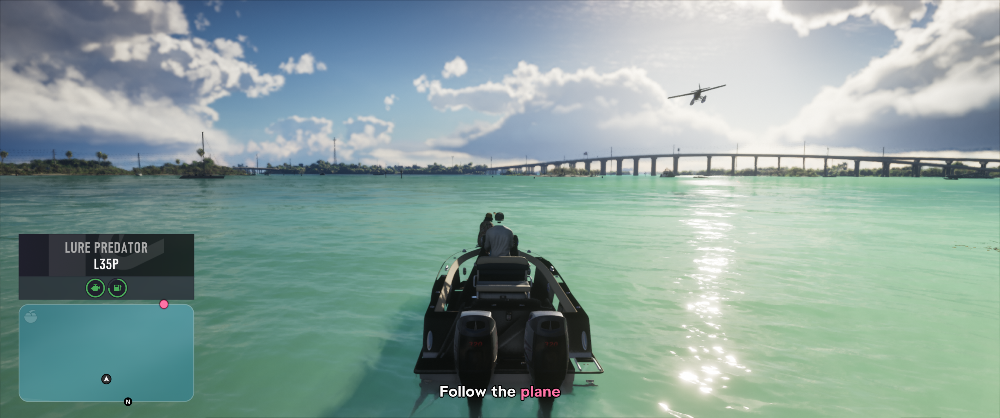

# GTA VI ultrawide for VIctory

A drop-in `dxgi.dll` that adds resolution, ultrawide, borderless fullscreen and FOV options to GTA VI (v1.0.2.1) running under [VIctory](https://github.com/Marvisak/VIctory). It works on any VIctory build or fork and changes nothing in VIctory itself.



## Features

- **Any resolution** (`res_x`, `res_y`, 640x360 up to 7680x4320): 16:9, 21:9, 32:9, 16:10, 4:3 and other aspects. 3D, cutscenes, pause menu and UI composite all follow the chosen size.
- **Correct aspect**: the camera uses the real aspect (Hor+), so the picture isn't stretched in 3D.
- **Borderless fullscreen** (`borderless_fullscreen`): a borderless window covering the monitor, on Linux and Windows.
- **FOV scale** (`fov_scale`): multiplies the camera field of view (1.2 = 20% wider).
- **Opt-in**: every option is empty by default and an empty option does nothing, so the shipped config leaves the game exactly as VIctory runs it.
- **Safe**: the ini is created once and never overwritten, unknown keys are ignored, and the dll checks every byte it patches. A different game build or an already-patched exe is left alone.
- **Read-only game folders work**: if the game dir can't be written (for example victory-proton), the dll patches the game in memory instead of the exe.

## Install

1. Copy `dxgi.dll` next to `victory.exe`.
2. Linux/Proton only: add `dxgi=n,b` to `WINEDLLOVERRIDES`. Windows needs nothing.
3. Start the game. `uw-options.ini` is created next to the dll; edit it and restart.

To uninstall, delete `dxgi.dll` (and restore `game_scarlett_master.exe` from `game_scarlett_master.exe.bak-uw` if that file exists).

## Options (`uw-options.ini`)

| Key | Value | Effect |
|---|---|---|
| `res_x`, `res_y` | pixels; set both or neither | output resolution |
| `borderless_fullscreen` | `true` / `false` | borderless window over the monitor; a different aspect than the monitor stretches |
| `fov_scale` | 0.5 - 2 | camera FOV multiplier |

## Known issues

- On screens wider than 16:9, some UI is stretched horizontally (chapter titles, the "Just Like Paradise" title) and the intro cutscene is stretched.
- The intro cutscene can jitter on some forks (seen on the 7900XTX fork; not tied to this mod).
- No `ui_scale`, no black-bar option and no scale-to-fit yet (see `archive/` for the abandoned smart-scaling attempt and why).
- Keyboard and mouse don't work in the UI on at least one fork; use a controller there.
- Works only on GTA VI v1.0.2.1.
- The game is slow on Linux while shaders warm up (the first minutes), independent of this mod.

## Build

```
cargo build --release   # target x86_64-pc-windows-gnu, output dxgi.dll
```

To add a fix: one function in `src/patches.rs`, one key in `src/options.rs`, rebuild, copy the dll.
