# VI-Ultrawide

A drop-in `dxgi.dll` that brings ultrawide and any-resolution support to GTA VI (v1.0.2.1), with a properly scaled HUD. It is made for [VIctory](https://github.com/Marvisak/VIctory) and its forks and changes nothing in VIctory itself.

<p align="center">
  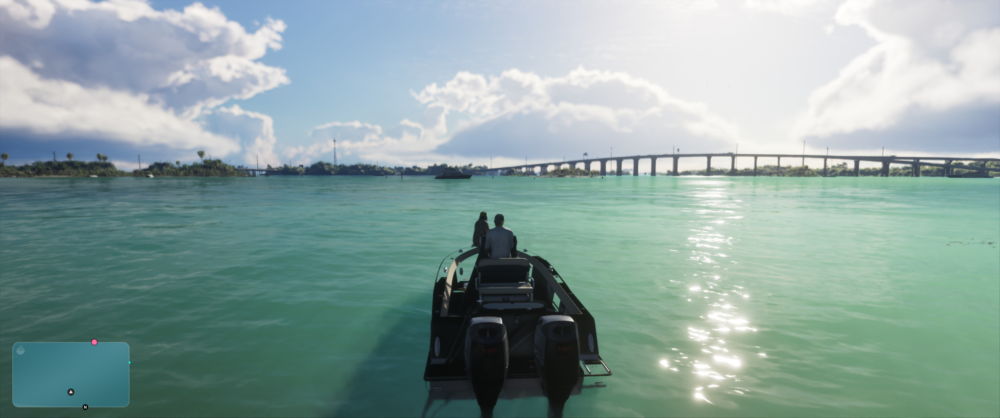
  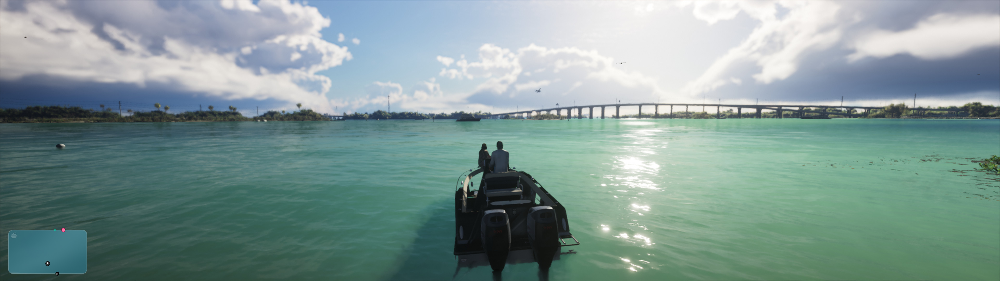
  <br>
  <sub>3440x1440 &amp; 3840x1080 respectively · 7900XTX, 9950X3D · run on <a href="https://git.disroot.org/bonaza/breakwater-victory-7900xtx">bonaza/breakwater-victory-7900xtx</a> · v0.1.2</sub>
</p>

<details>
<summary><b>21:9 Previews</b></summary>
<br>

<p align="center">
  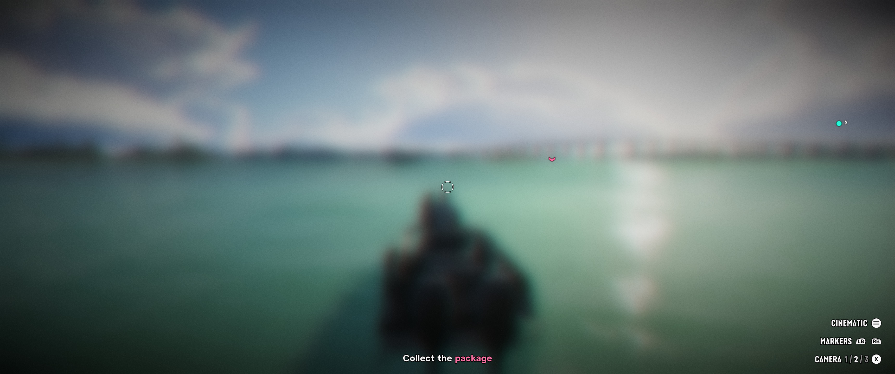
</p>
<p align="center">
  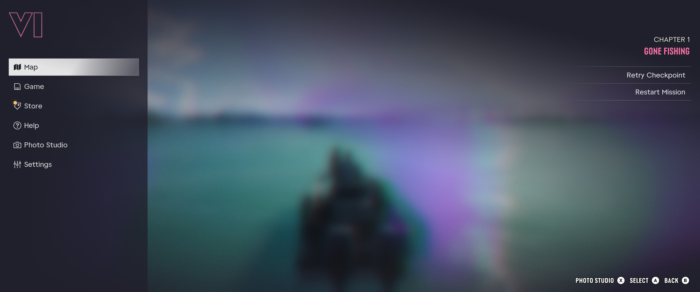
</p>
<p align="center">
  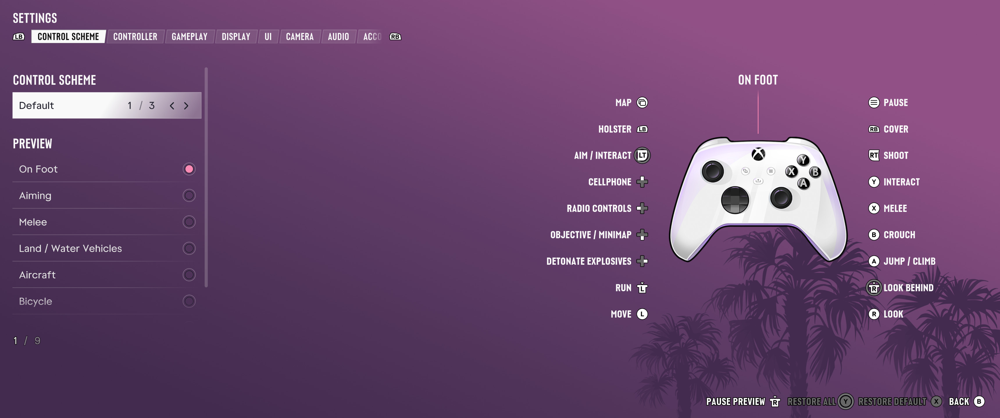
</p>
<p align="center">
  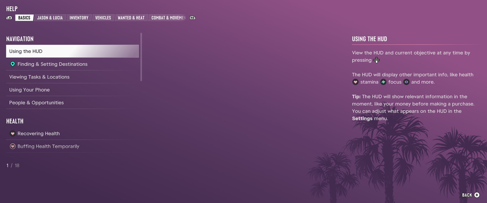
</p>
<p align="center">
  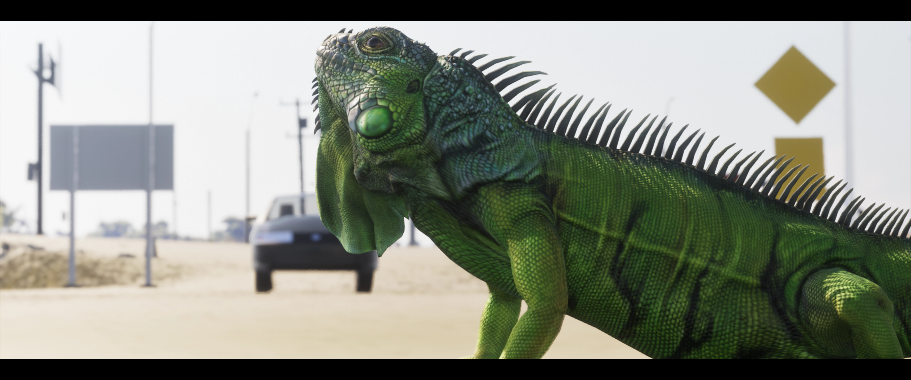
</p>
<p align="center"><sub>3440x1440 · 7900XTX, 9950X3D · run on <a href="https://git.disroot.org/bonaza/breakwater-victory-7900xtx">bonaza/breakwater-victory-7900xtx</a> · v0.1.2</sub></p>

</details>

<details>
<summary><b>32:9 Previews</b></summary>
<br>

<p align="center">
  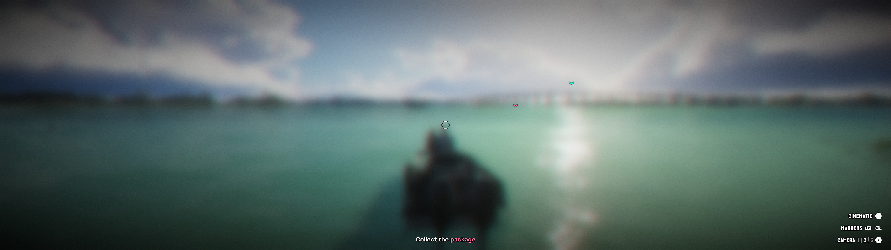
</p>
<p align="center">
  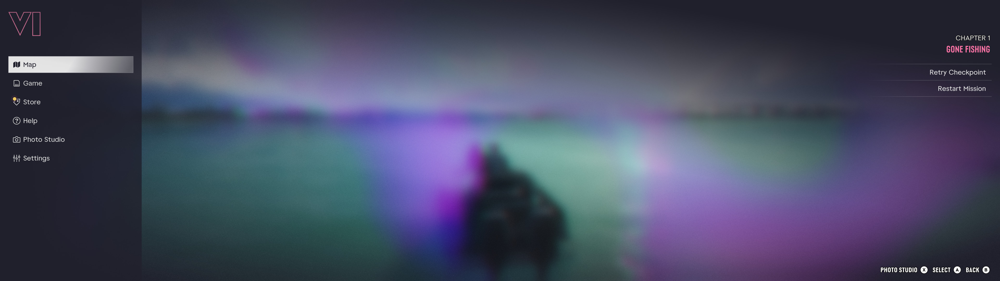
</p>
<p align="center">
  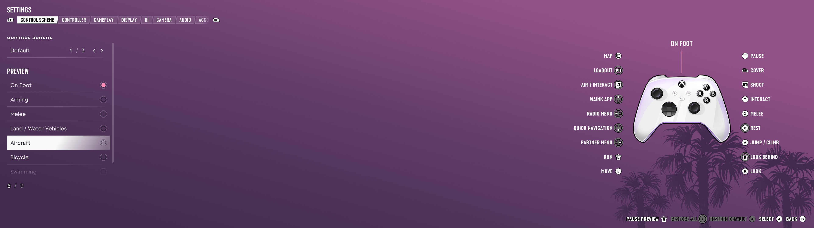
</p>
<p align="center">
  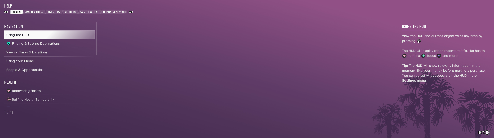
</p>
<p align="center">
  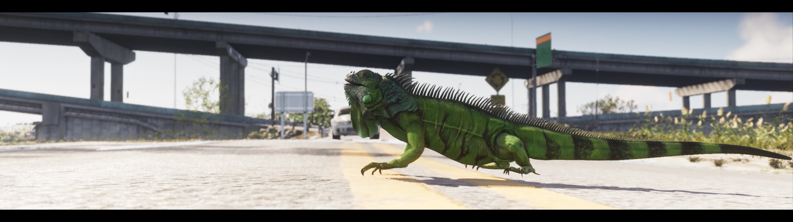
</p>
<p align="center"><sub>3840x1080 · 7900XTX, 9950X3D · run on <a href="https://git.disroot.org/bonaza/breakwater-victory-7900xtx">bonaza/breakwater-victory-7900xtx</a> · v0.1.2</sub></p>

</details>

<details>
<summary><b>8K &amp; 64:9 Previews</b></summary>
<br>

<p align="center">
  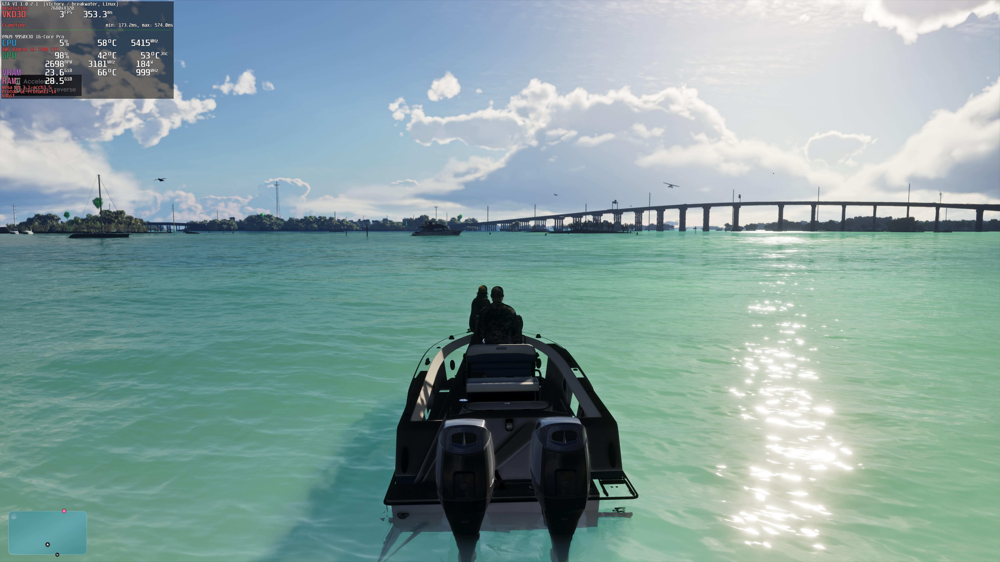
</p>
<p align="center"><sub>7680x4320, rendered natively (not upscaled) · 7900XTX, 9950X3D · run on <a href="https://git.disroot.org/bonaza/breakwater-victory-7900xtx">bonaza/breakwater-victory-7900xtx</a> · v0.1.2</sub></p>

<p align="center">
  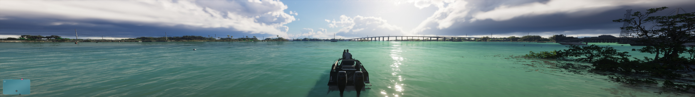
</p>
<p align="center">
  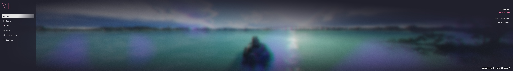
</p>
<p align="center">
  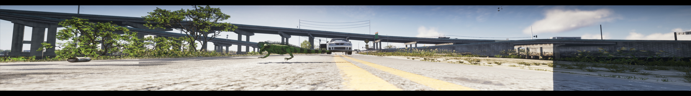
</p>
<p align="center"><sub>7680x1080 (64:9) · 7900XTX, 9950X3D · run on <a href="https://git.disroot.org/bonaza/breakwater-victory-7900xtx">bonaza/breakwater-victory-7900xtx</a> · v0.1.2</sub></p>

</details>

## Features

- **Automatic resolution**: runs at your monitor's resolution out of the box (`auto_res`).
- **Any resolution and aspect**: 640x360 up to 7680x4320, so 16:9, 21:9, 32:9, 16:10, 4:3 and more (`res_x`, `res_y`).
- **Field of view (FOV) scaling**: 3D and cutscenes use the real aspect, so nothing is stretched. `fov_scale` widens or narrows it.
- **Proper UI adjustment**: the HUD, minimap, D-pad markers and menus keep their 4K proportions and sit in the right place at any resolution. `hud_scale` makes them smaller or larger.
- **Native rendering**: optionally turn off the game's built-in upscaling for a sharper picture (`disable_fsr`).
- **Borderless fullscreen**: fitted to the monitor with black bars, or stretched (`borderless_fullscreen`).

## Tested on

| Fork | Result | OS | Hardware |
|---|---|---|---|
| [bonaza/breakwater-victory-7900xtx](https://git.disroot.org/bonaza/breakwater-victory-7900xtx) | 3440x1440, 3840x1080, 5120x1440, 7680x1080, 7680x4320 | CachyOS | 7900XTX |
| [avatarmanz/VIctory-7900XTX](https://github.com/avatarmanz/VIctory-7900XTX) | 3440x1440 | CachyOS | 7900XTX |
| [kroeeee-eeee/VIctory-Linux-Proton-Wine-7900XT-XTX](https://github.com/kroeeee-eeee/VIctory-Linux-Proton-Wine-7900XT-XTX) | 3440x1440 | CachyOS | 7900XTX |
| [louketa/paulistalow](https://github.com/louketa/paulistalow) | 5120x1440 | Windows | RTX 5090 |

## Install

1. Copy `dxgi.dll` next to VIctory's own `victory.exe`.
2. Linux/Proton only: add `dxgi=n,b` to `WINEDLLOVERRIDES`. Windows needs nothing.
3. Start the game. It runs at your monitor's resolution, and `uw-options.ini` is created next to the dll. Edit it and restart to change anything.

To uninstall, delete `dxgi.dll` and `uw-options.ini`.

## Options (`uw-options.ini`)

| Key | Value | Effect |
|---|---|---|
| `auto_res` | `true` (default) / `false` | while `res_x` and `res_y` are empty, use the monitor's resolution |
| `res_x`, `res_y` | pixels; set both or neither | output resolution (overrides `auto_res`) |
| `borderless_fullscreen` | `true` / `stretch` / `false` | borderless window over the monitor: `true` keeps the picture's shape (black bars when it differs from the monitor), `stretch` fills the monitor |
| `fov_scale` | 0.5 - 2 | camera FOV multiplier |
| `hud_scale` | 0.8 - 2 | HUD and menu size: empty or `1` = 4K proportions, `0.8` = 20% smaller, `2` = twice as large |
| `disable_fsr` | `true` / `false` | `true` turns off the game's built-in upscaling (it renders at 2/3 of the resolution and upscales): sharper, heavier on the GPU |

Old ini files gain the new options automatically on the next start; your values are kept.

## Known issues

- **Pause-menu map**: below 2160p, the map's cursor circle and icons are drawn offset towards the bottom right and don't follow the map when you pan it. A fix is in progress.
- On screens wider than 16:9, some title cards are stretched horizontally (chapter titles, "Just Like Paradise") and the intro cutscene is stretched.
- The intro cutscene can jitter on some forks (seen on the 7900XTX fork).
- At 7680x1080, a lighting seam shows near the right edge in some outdoor cutscenes.
- Works only on GTA VI v1.0.2.1.

## To-Do

- Fix the pause-menu map under UI scaling
- Toggleable black bars
- Fix the stretched title cards and intro cutscene on ultrawide
- Test on more forks and on Windows

## Feedback

Issues are very welcome and appreciated: bugs, broken UI, crashes, or results on a fork, GPU or resolution not listed above. Please [open an issue](https://github.com/outcome/VI-Ultrawide/issues) with your fork, GPU, resolution and `uw-options.ini`, plus a screenshot if something looks off.

## Build

```
cargo build --release   # target x86_64-pc-windows-gnu, output dxgi.dll
```

To add a fix: one function in `src/patches.rs`, one key in `src/options.rs`, rebuild, copy the dll.
